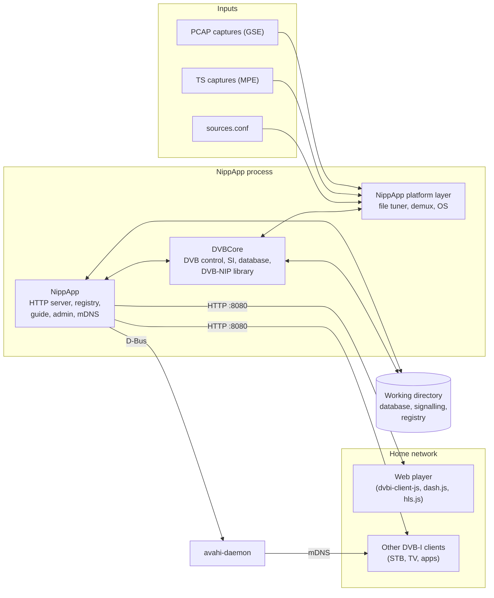
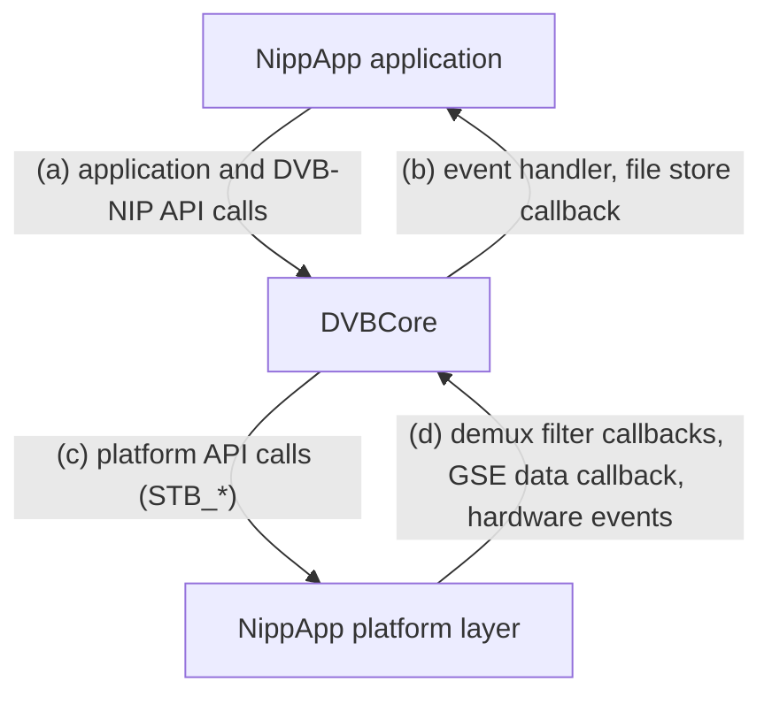
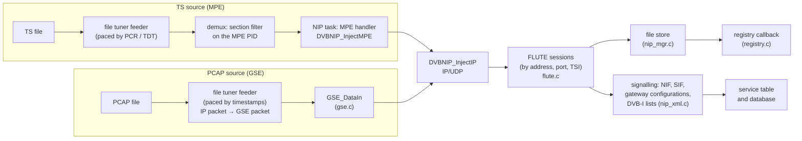
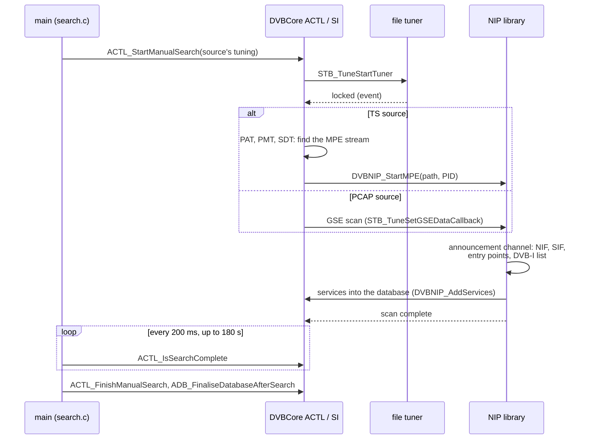
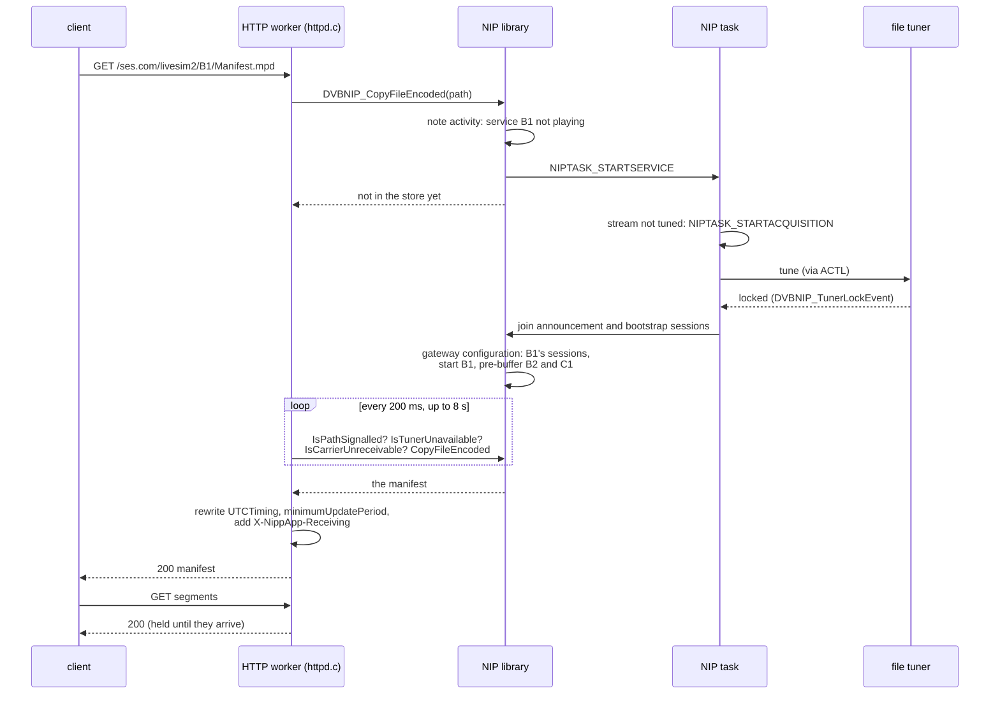
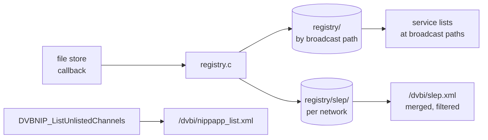
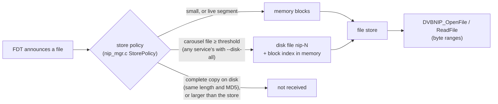
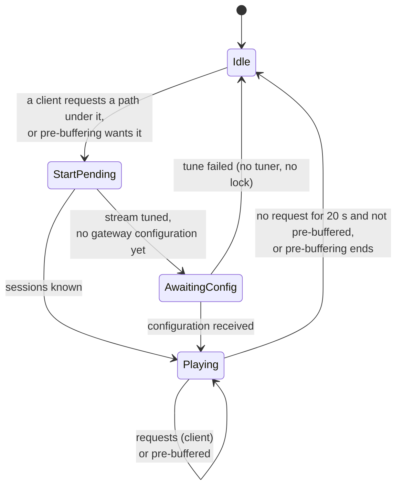

# NippApp architecture

NippApp version 0.1.0, with DVBCore branch `dvbnip-gateway`

This document describes how NippApp is built: its components, how it uses
DVBCore and what it provides to it, its threads, and how data moves from a
carrier to a client. It is for engineers working on NippApp or on DVBCore's
DVB-NIP library. How to build and run NippApp is in the
[user manual](USER_MANUAL.md). The decisions taken during development, with
the test results behind them, are recorded in [DESIGN.md](../DESIGN.md).

Clause numbers refer to the DVB-NIP specification (DVB A180r3, draft ETSI
TS 103 876) unless another document is named. DVB-I clause numbers refer to
ETSI TS 103 770.

Contents:

1. [Purpose and scope](#1-purpose-and-scope)
2. [System context](#2-system-context)
3. [Layers](#3-layers)
4. [NippApp's components](#4-nippapps-components)
5. [DVBCore's components](#5-dvbcores-components)
6. [Interfaces between NippApp and DVBCore](#6-interfaces-between-nippapp-and-dvbcore)
7. [Threads](#7-threads)
8. [Data flows](#8-data-flows)
9. [Service and tuner lifecycle](#9-service-and-tuner-lifecycle)
10. [Persistent state](#10-persistent-state)
11. [Build and dependencies](#11-build-and-dependencies)
12. [Extending NippApp](#12-extending-nippapp)

---

## 1. Purpose and scope

NippApp is a headless DVB-NIP home gateway, model DM3 of the specification
(clause 5): it receives DVB-NIP carriers and serves the DVB-I clients on the
home network, which need no knowledge of broadcast. It:

- searches DVB-NIP carriers, MPE in a transport stream and GSE, and stores
  the services found in DVBCore's channel database;
- acts as the local DVB-I service list registry for the broadcast service
  list entry points and lists (clause 8.1.7);
- tunes the right carrier when a client asks for something the signalling
  lists, and releases it when it is no longer used (clause 8.5.3);
- serves manifests, segments, service lists, content guide data and object
  carousel files over HTTP, at their broadcast paths (clause 8.2.8);
- answers DVB-I entry point and content guide queries, and announces itself
  with DNS-SD over mDNS (clause 11.1).

DVBCore does the broadcast work: tuning, demultiplexing, the DVB SI search,
the channel database, and in its DVB-NIP library the GSE and MPE
decapsulation, FLUTE reception, the NIP signalling and the store of received
files. NippApp is the application around it: the platform layer DVBCore runs
on, the HTTP server, the DVB-I endpoint and the gateway's policies.

Until tuner hardware is supported, NippApp's platform layer includes a
*file tuner*, which plays captures in real time in place of a tuner.

## 2. System context



NippApp is one process. The web player is a set of static files that NippApp
serves; it runs in the client's browser and uses only the gateway's public
DVB-I endpoints.

## 3. Layers

```
+--------------------------------------------------------------------------+
| NippApp application (src/)                                               |
|   main  search  events  httpd  registry  guide  admin  encoding  mdns    |
+-----------------------------+--------------------------------------------+
| DVBCore application API     | DVBCore DVB-NIP library API                |
|   APP_, ACTL_, ADB_, ASI_,  |   DVBNIP_* (dvbnip/inc/nip_mgr.h)          |
|   ACFG_ (dvb/inc)           |                                            |
+-----------------------------+--------------------------------------------+
| DVBCore                                                                  |
|   dvb/ (control, SI search, database)    dvbnip/ (NIP manager, NIP task, |
|   midware/stb/ (resource manager,                  FLUTE, GSE, XML)      |
|                 decode paths)                                            |
+--------------------------------------------------------------------------+
| DVBCore platform API: STB_* (DVBCore/platform/inc)                       |
+--------------------------------------------------------------------------+
| NippApp platform layer (platform/)                                       |
|   os/: tasks, mutexes, queues, semaphores, events, clock (Linux)         |
|   hw/: file tuner, demux, disk, memory, network, stubs                   |
+--------------------------------------------------------------------------+
| Linux: pthreads, sockets, files                                          |
+--------------------------------------------------------------------------+
```

DVBCore calls down into the platform layer through the `STB_*` platform API,
and NippApp calls into DVBCore through its application and DVB-NIP APIs.
DVBCore calls back up through an event handler, a file store callback and
the demux and GSE callbacks the platform layer drives.

NippApp keeps its own copy of the platform layer rather than building
DVBCore's reference application's (`App/platform`), so that its repository
depends only on DVBCore. The copied files, their source and their changes
are listed in [platform/COPIED.md](../platform/COPIED.md).

## 4. NippApp's components

### 4.1 Application modules (`src/`)

| Module | Responsibility |
|---|---|
| `main.c` | Command-line options, startup order, the main loop (runs scans asked for through the admin API, waits for a stop signal), shutdown. Owns the pre-buffering setting. |
| `search.c` | First-run setup (country, satellite and LNB records) and searches: one manual search per source, as DVBCore's reference application does them. |
| `events.c` | DVBCore's application event handler (`NIPPAPP_EventHandler`): logs tuner and search events. |
| `httpd.c` | The HTTP server (civetweb): request routing, serving files from the NIP library or the registry, waiting for signalled files, the 404/501/503 rules, DVB-I and MPD rewriting, the AAC configuration fix, `/time`, the player's files, the admin routes. |
| `registry.c` | The DVB-I registry: keeps every DVB-I document received on disk, merges every network's entry points into `/dvbi/slep.xml`, filters entry point queries, builds `/dvbi/nippapp_list.xml` for services no broadcast list covers. |
| `guide.c` | The content guide endpoint: answers schedule and now/next queries from the TV-Anytime documents in the broadcast's guide carousels. |
| `admin.c` | `/api/status` JSON. |
| `encoding.c` | Decodes files sent compressed (gzip, zlib, deflate) with zlib. |
| `mdns.c` | The DNS-SD announcement through avahi-daemon (libavahi-client): `_dvbservdsc._tcp` and `_http._tcp` on each IPv4 interface. Built only when libavahi-client is available. |

`inc/nippapp.h` is the interface between these modules (`NIPPAPP_`,
`HTTPD_`, `REG_`, `GUIDE_`, `ADMIN_`, `ENC_`, `MDNS_` functions).

### 4.2 Platform layer (`platform/`)

DVBCore expects about 400 platform functions. Only those for tuning,
demultiplexing, the OS, memory, storage and networking do real work; the
rest are empty.

| File | Provides |
|---|---|
| `os/stbos_*.c` | Tasks, mutexes, semaphores, queues, events and clock on Linux (copied from DVBCore's reference application) |
| `hw/src/stbhwtun.c` | The **file tuner**: reads the sources file, matches each tune to a source, reports lock, feeds the capture in real time. TS is fed to the demux, paced by its PCR (or TDT/TOT). PCAP is wrapped one IP packet per GSE packet and fed to the GSE data callback DVBCore registered, paced by capture timestamps. Offers 2 tuner paths. Also keeps the broadcast time of the capture, a fallback clock. |
| `hw/src/stbhwdmx.c` | The **demux**: PID and section filtering of the TS the file tuner delivers, with DVBCore's filter callbacks run on a delivery task per demux path. No PES or decoding. |
| `hw/inc/nipphw.h` | The interface between the file tuner, the demux and NippApp: `TUN_LoadSources`, `TUN_GetSource`, `TUN_GetTunerState`, `TUN_GetBroadcastTime`, `DMX_FeedPackets`. |
| `hw/src/stbhwdsk.c` | Storage: DVBCore's "disks" are directories under `disks/` in the working directory. |
| `hw/src/stbhwmem.c`, `stbhwnet.c`, `stbhwcrypt.c`, `stbhwplatform.c`, `stbhwini.c`, `stbhwsp.c`, `celo.c` | Memory, network, crypto, platform and initialisation functions (copied) |
| `hw/src/stubs.c` | Empty AV decoding, OSD, front panel, PVR, VBI and EBU functions: a headless gateway decodes nothing |

### 4.3 Other parts

| Directory | Content |
|---|---|
| `player/` | The web player (`player.html`), and `vendor/` (built by `tools/build-player.sh`, not in git): dvbi-client-js, dash.js 4.7.4, hls.js 1.5.20 |
| `third_party/civetweb/` | civetweb 1.16 (MIT), built without TLS, CGI and file serving; every request goes to NippApp's handler |
| `tools/` | `build-player.sh`, `package.sh` (portable tarball), `asan-check.sh` (AddressSanitizer test scenarios), `make-carousel-pcap.py` (a test capture with a large carousel file) |

## 5. DVBCore's components

### 5.1 The parts NippApp uses

| DVBCore part | Location | What it does for NippApp |
|---|---|---|
| DVB control (ACTL) | `dvb/src/ap_cntrl.c` | Searches, tuning to transports, tuner events |
| SI handling | `dvb/src/ap_si.c` | The SI search; recognises a DVB-NIP carrier (data broadcast descriptor, or an MPE stream of PMT stream type 0x0D, clause 7.3.3) and starts the NIP library's MPE or GSE scan |
| Database (ADB, DBDEF) | `dvb/src/ap_dbacc.c`, `ap_dbdef.c` | Satellites, LNBs, transports and services, kept in SQLite |
| Configuration (ACFG) | `dvb/src/ap_cfg.c` | Country, which decides LCN allocation |
| Resource manager | `midware/stb/` | Tuner and decode path allocation (`STB_DPAcquireTunerPath`) |
| **DVB-NIP library** | `dvbnip/` | Everything specific to DVB-NIP, below |

### 5.2 The DVB-NIP library (`dvbnip/`)

| File | Responsibility |
|---|---|
| `inc/nip_mgr.h` | The library's public API (`DVBNIP_*`) |
| `src/nip_mgr.c` | The NIP manager: the service table (NIP streams and the services on each, from the NIF and SIFs), FLUTE session management, the file store and its limits, on-demand service start and stop, pre-buffering, the broadcast wall clock, persistence of the signalling, putting services into the database, garbage collection |
| `src/nip_task.c` | The NIP task: one thread with a message queue. It tunes and releases NIP streams (MPE and GSE acquisitions), finds the MPE PID from the PAT and PMT after a restart, follows tuner lock, starts and stops services, and runs the garbage collector |
| `src/flute.c` | FLUTE reception: LCT/ALC packets, the FDT, file reassembly into memory or the disk store, EXT_TIME |
| `src/gse.c` | GSE decapsulation of a GSE carrier's data into IP packets |
| `src/nip_xml.c` | Parsing of the NIP signalling: NIF, SIF, gateway configurations (including object carousels), DVB-I service lists |
| `src/nip_misc.c` | Path matching and helpers |

The NIP manager's main structures:

- **Streams** (`S_STREAM_INFO_ITEM`): one per NIP stream (network ID, carrier
  ID, service ID), with its tuning state: acquired (tuned), lock count, no
  tuner, no signal.
- **Services** (`S_SERVICE_INFO_ITEM`): one per SIF entry, under its stream:
  its path (a manifest, a file, or a directory), its multicast transports
  from the gateway configuration, and its state (playing, start pending,
  awaiting configuration, pre-buffered, client references, last activity,
  memory used). An object carousel's entry also keeps the list of resources
  it carries.
- **File store**: every file FLUTE has delivered, by path, with its type,
  encoding, owner service, receive times and a count of readers holding it
  open. A file's data is in memory (a list of received blocks) or, with a
  disk store, in a file on disk with an index of its blocks in memory (see
  [section 8.7](#87-the-disk-store)).

## 6. Interfaces between NippApp and DVBCore

There are four directions of interface:



### 6.1 (a) NippApp calls into DVBCore

**Initialisation, search and database** (`main.c`, `search.c`, `admin.c`):

| Call | Used for |
|---|---|
| `APP_InitialiseDVB(NIPPAPP_EventHandler, DVB_INIT_NO_TELETEXT_OR_SUBTITLES)` | Start DVBCore: its tasks, the database, the platform layer, and the DVB-NIP library (`DVBNIP_Init`) |
| `ACFG_GetCountry`, `ACFG_SetCountry` | The country, set on the first run |
| `ADB_GetNextSatellite`, `ADB_AddSatellite`, `ADB_GetNextLNB`, `ADB_AddLNB` | A satellite record ("NippApp") and a universal LNB on the first run |
| `ASI_SetSearchServiceType` | Search for DVB-NIP services (and DVB-NIP GSE for PCAP sources) |
| `ADB_PrepareDatabaseForSearch`, `ACTL_StartManualSearch`, `ACTL_IsSearchComplete`, `ACTL_FinishManualSearch`, `ADB_FinaliseDatabaseAfterSearch` | One manual search per source: `ACTL_FREQ_SEARCH` for TS, `ACTL_DVBNIP_GSE_SEARCH` for PCAP |
| `ADB_GetServiceList`, `ADB_GetServiceFullName`, `ADB_GetServiceLcn`, `ADB_GetServiceIds`, `ADB_GetServiceType`, `ADB_ReleaseServiceList`, `ADB_GetNumServicesInList` | Print the channels after a search; count them for status |
| `ADB_SaveDatabase` | Save the database at shutdown |

**DVB-NIP library** (`httpd.c`, `registry.c`, `guide.c`, `admin.c`, `main.c`):

| Call | Used for |
|---|---|
| `DVBNIP_OpenFile`, `DVBNIP_ReadFile`, `DVBNIP_CloseFile` | Open a received file by path, read it in parts, close it: how `httpd.c` serves files, whole or in byte ranges. **Opening a path under a service starts that service**, which tunes its carrier on demand. A manifest that lists segments received before its service last started isn't returned. The file is kept until closed. |
| `DVBNIP_CopyFileEncoded`, `DVBNIP_CopyFile` | Copy a received file whole, with its type and content encoding (the guide and the registry). Also starts the service. |
| `DVBNIP_IsPathSignalled` | Whether any SIF lists the path, or a directory or service it is under: if not, 404 at once |
| `DVBNIP_IsTunerUnavailable` | Whether the path's carrier couldn't be tuned for want of a tuner: 503 |
| `DVBNIP_IsCarrierUnreceivable` | Whether the path's carrier didn't lock: 503 |
| `DVBNIP_IsCarouselPath` | Whether a file comes from an object carousel: 503 rather than 404 while it hasn't come round |
| `DVBNIP_GetServiceReceivingTime` | How long the path's service has been received, for `X-NippApp-Receiving` |
| `DVBNIP_GetWallClock` | The broadcast wall clock from EXT_TIME, for `/time` and the guide's now/next |
| `DVBNIP_EnumFiles` | List the file store (index page) |
| `DVBNIP_SetFileStoreCallback` | Register the registry's callback for every file stored |
| `DVBNIP_ListUnlistedChannels` | The channels no received DVB-I list covers, for `/dvbi/nippapp_list.xml` |
| `DVBNIP_ListCarouselResources` | The files a guide carousel carries |
| `DVBNIP_ListStreams`, `DVBNIP_GetStoreUsage` | Streams, services being received and memory use, for `/api/status` |
| `DVBNIP_SetPrebuffer` | The most channels pre-buffered per stream (`--prebuffer`) |
| `DVBNIP_SetDiskStore`, `DVBNIP_GetDiskStoreUsage` | The disk store (`--store-dir`, `--disk-threshold`, `--disk-limit`, `--disk-all`), and its use for `/api/status` |

NippApp never tunes directly. Every tune is started by DVBCore, either by a
search or by the NIP library when a request needs a carrier.

### 6.2 (b) DVBCore calls NippApp

| Callback | Registered with | Called |
|---|---|---|
| `NIPPAPP_EventHandler(event, data, size)` | `APP_InitialiseDVB` | For DVBCore's application events (tuner lock, search finished). On DVBCore's event task. NippApp only logs them. |
| `FileStored(user_data, file)` (`registry.c`) | `DVBNIP_SetFileStoreCallback` | For each file the NIP library stores. The registry keeps a copy of each DVB-I document on disk. On the thread that completed the file. |

### 6.3 (c) DVBCore calls the platform layer

The platform API is declared in `DVBCore/platform/inc`. The parts with real
code in NippApp:

| Area | Functions (examples) | NippApp's implementation |
|---|---|---|
| Tuner | `STB_TuneInitialise`, `STB_TuneStartTuner`, `STB_TuneStopTuner`, `STB_TuneSetGSEDataCallback`, `STB_TuneGet*` | The file tuner: finds the source matching the tune (RF frequency from the IF and the LNB's local oscillator, polarisation from the LNB voltage), reports lock or no lock, starts the feeder thread |
| Demux | `STB_DMXInitialise`, `STB_DMXGrabPIDFilter`, `STB_DMXGrabSectFilter`, `STB_DMXSetupSectFilter`, `STB_DMXStartPIDFilter`, `STB_DMXCopyPIDFilterSect`, ... | Section filtering on the TS packets the file tuner feeds |
| OS | `STB_OSCreateTask`, `STB_OSCreateMutex`, `STB_OSCreateQueue`, `STB_OSReadQueue`, `STB_OSSendEvent`, `STB_OSGetClockMilliseconds`, ... | Linux threads and primitives |
| Storage | `STB_DSKOpenFile`, `STB_DSKReadFile`, `STB_DSKWriteFile`, `STB_DSKSeekFile`, ... | Files under `disks/` in the working directory: the NIP library's signalling, and the disk store |
| Memory, network, NVM | `STB_GetMemory`, `STB_IP*`, ... | Linux |
| AV, OSD, PVR, front panel, VBI | | Empty stubs |

### 6.4 (d) The platform layer calls DVBCore

| Path | From | To |
|---|---|---|
| Tuner lock | The file tuner, `STB_OSSendEvent(HW_EV_CLASS_TUNER, HW_EV_TYPE_LOCKED or NOTLOCKED)` | DVBCore's event task: `STB_EVENT_TUNE_LOCKED` or `NOTLOCKED`, handled by ACTL, which passes it to the NIP library (`DVBNIP_TunerLockEvent`) and to `NIPPAPP_EventHandler` |
| TS sections | The demux's delivery task, through the filter callback DVBCore set | DVBCore's SI handlers (PAT, PMT, SDT, NIT during a search) and the NIP task's MPE handler, which calls `DVBNIP_InjectMPE` |
| GSE data | The file tuner's PCAP feeder, through the callback set with `STB_TuneSetGSEDataCallback` | `GSE_DataIn` (gse.c), which decapsulates IP packets for `DVBNIP_InjectIP` |

### 6.5 Changes made in DVBCore for NippApp

NippApp needed DVBCore changes, all on branch `dvbnip-gateway`. The main ones:

- **Search:** the MPE stream found by PMT stream type 0x0D; a GSE manual
  search of one carrier; the NIP scan waits for the entry points and a DVB-I
  list (`ap_si.c`, `ap_cntrl.c`, `nip_mgr.c`).
- **Signalling:** a SIF per provider, every DVB-I list kept by its location,
  exact path matching before the looser match, object carousels in gateway
  configurations (`nip_mgr.c`, `nip_xml.c`).
- **On-demand tuning:** MPE PID found from the PAT and PMT after a restart,
  tune failure reporting (no tuner, no lock), tuners released with
  `ACTL_TuneOff`, the metadata monitor for tunes outside a search
  (`nip_task.c`, `nip_mgr.c`, `ap_cntrl.c`).
- **Serving:** fast 404, stale manifests not served after a re-tune, content
  encodings, carousel files kept until replaced, the wall clock from
  EXT_TIME, pre-buffering, and the status and listing calls
  (`nip_mgr.c`, `flute.c`).
- **Leaks** found by AddressSanitizer (`ap_dbdef.c`).

## 7. Threads

| Thread | Created by | Runs |
|---|---|---|
| Main | | Startup and shutdown; searches (the first run's, and those asked for through `/api/status`), polling `ACTL_IsSearchComplete`; otherwise waits for a stop signal |
| DVBCore event task | DVBCore | Platform and application events: tuner lock, search progress. Calls `NIPPAPP_EventHandler` |
| DVBCore SI and control tasks | DVBCore | The SI search and tuning control |
| NIP task | DVBCore (`nip_task.c`) | All NIP stream acquisitions and releases, service starts and stops, lock handling, garbage collection every 10 s. Its queue holds 100 messages. |
| File tuner feeders | NippApp (`stbhwtun.c`), one per tuned path | Read the capture and pace it. TS: reassemble sections (`DMX_FeedPackets`). PCAP: call the GSE data callback, and so FLUTE reception and file storage. |
| Demux delivery tasks | NippApp (`stbhwdmx.c`), one per demux path | Call DVBCore's section filter callbacks, and so MPE decapsulation, FLUTE reception and file storage |
| HTTP workers | civetweb, 32 threads | One request each: routing, waiting for files, rewriting, sending |
| Avahi poll thread | libavahi-client | The mDNS announcement and its callbacks |
| Ethernet monitor | NippApp platform (`stbhwnet.c`) | Network state, for DVBCore |

Concurrency rules:

- The NIP library's state is protected by its own mutexes: `session_sem` for
  FLUTE sessions, `streams_sem` for the service table, `file_store_sem` for
  the file store, taken in that order; and `mpe_acq_mutex` in the NIP task
  for its acquisitions. DVBCore's mutexes are recursive (`STB_OSCreateMutex`
  keeps an owner and a lock count), so a function holding one can call
  another that takes it.
- Calls from HTTP workers into the NIP library only read state or set flags.
  Anything that tunes or starts a service is sent as a message to the NIP
  task (`NIPTASK_STARTSERVICE`, `NIPTASK_STARTACQUISITION`, `NIPTASK_LOCK`,
  ...), so acquisitions are only changed on that one thread.
- An HTTP worker holds a reference to the file it sends (`DVBNIP_OpenFile`),
  not the store's lock, so sending a large file doesn't hold up reception.
  A complete file's data doesn't change, so it is read without the lock. A
  file replaced or dropped while it is open is freed when it is closed.
- Data written to the disk store is written on the receiving thread (the
  demux or PCAP feeder), appended to the file, with no copy when it
  completes.
- A search runs on the main thread while HTTP workers keep serving.

## 8. Data flows

### 8.1 From a carrier to the file store



- The NIP library joins only the FLUTE sessions it needs: the announcement
  channel (224.0.23.14:3937 TSI 0, clause 8.2.2) during a search and while a
  stream is tuned (the metadata monitor), the bootstrap sessions while a
  service waits for its gateway configuration, and each started service's
  media sessions.
- Every FLUTE packet's EXT_TIME updates the broadcast wall clock.
- A completed file goes into the file store at its path. The registry's
  callback keeps a copy of DVB-I documents on disk.
- A new NIF, SIF, gateway configuration or DVB-I list updates the service
  table. During a search, `DVBNIP_AddServices` puts the services into the
  database. Outside a search, a change is applied with
  `NIPTASK_UPDATESERVICES`.

### 8.2 Search



The sources file stands in for the preset list of bootstrap streams of Annex
C.4.1. A carrier without entry points or a DVB-I list completes on a 20 s
timeout.

### 8.3 A client request



`SendFile` (`httpd.c`) decides the answer:

1. Open the file in the NIP library (`DVBNIP_OpenFile`). If it is there, or
   the registry has a copy of a DVB-I document, serve it: a file on disk, one
   of 1 MB or more, or one asked for with a `Range` header is sent as it is
   read, in 256 KB pieces, whole (200) or the byte range asked for (206), as
   long as NippApp doesn't rewrite or decode it; anything else is read whole
   and served as below.
2. If no SIF signals the path, answer 404 at once.
3. If the carrier has no tuner free, answer 503 (`Retry-After: 10`). If it
   didn't lock, answer 503 (`Retry-After: 30`).
4. Otherwise wait 200 ms and try again, for up to 8 s. Then a carousel's file
   gets 503 (`Retry-After: 10`) and anything else 404.

Before sending, DVB-I documents have `http://dvb.gw/` replaced by the address
the client used (Annex F.2.1). MPDs get `UTCTiming` pointing at `/time` and
`minimumUpdatePeriod` 2 s (clause 9.1.2). Init segments get the AAC
configuration fix. Compressed files are decoded.

Requests are routed in `BeginRequestHandler`: `/api/` to the admin API,
`/`, `/time`, `/dvbi/slep.xml`, `/player/`, then requests with `src=DVB-HB`
(501), then the content guide endpoint (`GUIDE_Query`, for a guide
manifest's path with a query), and everything else to `SendFile`.

### 8.4 The DVB-I registry



- Every DVB-I document received is kept at its broadcast path, and written
  only when it changes. A list or the entry points are therefore served at
  once after a restart, or while their carrier isn't tuned (clauses 8.2.8,
  C.4.3). A request on a path the SIF lists still starts the carrier, so the
  copy is refreshed from the broadcast.
- The broadcast identifies the entry points only by URN
  (`urn:dvb:metadata:nativeip:dvb-i-slep`, clause 8.2.5.1), so the gateway
  chooses their URL, `/dvbi/slep.xml` (clause 8.1.7.3). Each network's entry
  points are kept by registry entity. With several networks, the first by
  name is served with every other network's `ProviderOffering` elements
  added.
- Entry point queries are filtered as TS 103 770 clause 5.1.3.2 requires
  (`REG_FilterEntryPoints`).
- Services no broadcast list covers are offered in `/dvbi/nippapp_list.xml`,
  made from the database when requested.

### 8.5 The content guide

A broadcast list's `ScheduleInfoEndpoint` is its NIP Content Guide Manifest.
`guide.c` answers queries on that path:

1. Read the manifest's `GuideSession` `TagRef`s and the NIP Service Guide
   Manifest (`urn:dvb:metadata:nativeip:ServiceGuide`): these name the
   object carousels carrying the guide.
2. List each carousel's resources (`DVBNIP_ListCarouselResources`) and fetch
   its TV-Anytime documents (`DVBNIP_CopyFileEncoded`), which tunes and joins
   the carousel. Until they are here, answer 503.
3. Decode and parse them, and keep them parsed until their content changes.
4. Select the service's events for the window, or now/next by the broadcast
   clock, and return a `TVAMain`.

### 8.6 The broadcast clock

The broadcast wall clock is the NTP time in each FLUTE packet's EXT_TIME
header extension (clause 8.6.1). The NIP library keeps it
(`DVBNIP_GetWallClock`), moving it only when it is out by more than 0.5 s.
`/time` serves it (clause 8.6.3); when there is no EXT_TIME yet, the file
tuner's capture time is used. Every MPD's `UTCTiming` points at `/time`, so
DASH players run on broadcast time. That is what lets recordings play "live".

There is one clock. With live reception every carrier has the same time; with
recordings from different times, it follows whichever carrier sent EXT_TIME
last.

### 8.7 The disk store

With `--store-dir`, files that don't fit in memory are received to disk:



- **The decision** is made per file when its FDT entry is parsed:
  `FLUTE_RegisterStorePolicy` gives each service session NIP manager's
  `StorePolicy`, which returns memory, disk or skip. Signalling sessions have
  no policy, so the NIF, SIF, gateway configurations and lists are always in
  memory.
- **Writing.** A disk file's packets are appended to `nip-<n>` as they
  arrive, and a sorted array in memory indexes them by block number (16
  bytes per 1 KB packet). The FEC payload ID gives the data's order, but not
  its position without the FEC parameters. Once the file is complete, each
  block's position in the object is worked out from the index, and reads
  find their blocks by binary search. Nothing is copied at completion.
- **Carousel passes.** An incomplete disk file is kept for 10 minutes without
  packets (`DISK_FILE_TIMEOUT`, against 30 s in memory), so later passes of
  the carousel fill its gaps. The policy skips a file already complete on
  disk with the same length and Content-MD5.
- **Limits.** Memory files count against the memory limits, disk files
  against `--disk-limit`; the garbage collector drops the oldest complete
  disk files when the store is over its limit.
- **Location.** The store is `store/` on the NIP library's disk
  (`disks/nip/store`), a link NippApp makes to `--store-dir`, accessed only
  through the platform's disk API. It is emptied of `nip-*` files at
  startup.

## 9. Service and tuner lifecycle

### 9.1 States



A stream (carrier) is tuned while any of its services is starting or
playing. When the last one stops, the tuner is released 10 s later. A stream
waiting for a tuner can take one that is only waiting to be released.

### 9.2 Timers and limits

| Value | Where | Meaning |
|---|---|---|
| 8 s, in 200 ms steps | `httpd.c` `HOLD_MS` | How long a request waits for a signalled file that hasn't arrived |
| 10 s | `nip_mgr.c` `GARBAGE_COLLECTION_PERIOD` | How often services, tuners and the file store are checked |
| 20 s | `SERVICE_IDLE_TIME` | A service with no client references stops after this long without requests |
| 5 s | `SERVICE_STOP_GRACE` | A service whose last client reference was released keeps running while its files were requested this recently, and its tuner isn't taken for another stream |
| 10 s | `STREAM_IDLE_TIME` | A tuner is released this long after the last of its services stopped |
| 10 s | `NO_SIGNAL_RETRY_TIME` | A stream that didn't lock isn't tuned again for this long |
| 30 s | `DEFAULT_MAX_AGE_CONTENT` | A received file is kept this long (carousel files: until replaced) |
| 12 s | `PREBUFFER_MAX_AGE` | A pre-buffered service's files are kept this long |
| 30 s | `FLUTE_FILE_TIMEOUT` | An incomplete file that has received nothing for this long is dropped |
| 600 s | `DISK_FILE_TIMEOUT` | The same for a file being received to disk, so later passes of its carousel can complete it |
| 4 MB, 2 GB | `main.c` `DEFAULT_DISK_THRESHOLD`, `DEFAULT_DISK_LIMIT` | The size from which carousel files go to disk, and the disk store's limit (`--disk-threshold`, `--disk-limit`) |
| 1 MB, 256 KB | `httpd.c` `STREAM_MIN_LEN`, `STREAM_CHUNK` | The size from which a file is sent as it is read rather than copied whole, and the pieces it is read in |
| 256 MB, 128 MB | `DEFAULT_MAX_MEMORY_USAGE`, `DEFAULT_MAX_SERVICE_MEMORY_USAGE` | The file store's total and per-service limits; the oldest files go first |
| 10 s, 30 s, 10 s | `httpd.c` | `Retry-After` for no tuner, no signal, a carousel file |
| 180 s | `search.c` | The limit on one search |
| 2 | `stbhwdef.h` `NUM_TUNER_PATHS` | Tuner paths the file tuner offers |

Because the checks run every 10 s, in practice a service stops 20-40 s after
its last request, and its tuner is released 10-20 s after that. A stream
waiting for a tuner takes one whose services have stopped at once, without
waiting for the release.

### 9.3 Pre-buffering

When a service a client asked for starts (`StartService`), and at each
garbage collection, `UpdatePrebuffer` brings its stream's pre-buffering up
to date:

1. The *watched* service is the first presentation service (DASH or HLS) on
   the stream that a client is using.
2. Every other channel on the stream is pre-buffered once, up to the limit
   set with `DVBNIP_SetPrebuffer`, in stream order: in the watched service's
   format if the channel has it, otherwise in its other format. A channel
   that a client is using in any format is skipped.
3. A channel the client has left stays running, as a pre-buffered one.
4. When no client uses a channel on the stream, the pre-buffered services
   are stopped, and the tuner is released as usual.

A pre-buffered service keeps only 12 s of files. A request for one of its
files makes it a client's service again. Several services can share a
directory: SES signals each channel's DASH manifest and HLS playlist side by
side. A file that is neither's manifest goes to the one being received
(`FindServiceForPath`, `DirectoryClaim`).

### 9.4 Tune failures

| Failure | Detected by | Result |
|---|---|---|
| No tuner path free | `TuneToNipService` can't acquire a path | An idle stream's tuner is released and the tune retried; otherwise the stream is marked *no tuner* until a tuner is freed or a new request retries: 503 |
| No lock | the tuner reports not locked before it has locked (`HandleLockEvent`) | The path is released and the stream marked *no signal* for 10 s: 503. A stream that loses lock after locking is kept, as a real tuner may lock again |
| No transport for the stream | `TuneToNipService` | As for no lock |

## 10. Persistent state

| Data | Owner | Where |
|---|---|---|
| Channel database | DVBCore | `dtvkit.sqlite3` |
| Settings (country) | DVBCore | `nvm.dat` |
| NIF, SIFs, DVB-I lists | NIP library | `disks/nip/` (`nif.xml`, `sif*.xml`, `dvbisl*.xml` + `.loc`) |
| DVB-I documents | NippApp registry | `registry/` |
| Large received files | NIP library (FLUTE) | `disks/nip/store` → `--store-dir`; not kept across restarts |
| Entry points per network | NippApp registry | `registry/slep/` |

At startup the NIP library rebuilds its service table from `disks/nip/`, so
services can be tuned after a restart without a search. The file store
isn't kept across restarts, on disk or in memory.

## 11. Build and dependencies

NippApp's Makefile compiles its own sources, the platform layer and civetweb,
and links them with DVBCore's `libdvbcore.a`. DVBCore must be built with
DVB-NIP and SQLite integrated (`DTVKIT_INTEGRATE_DVBNIP=1`,
`DTVKIT_INTEGRATE_SQLITE=1`, `DTVKIT_USE_STDINT=1`), which DVBCore's
`example_setenv.sh` sets. NippApp defines the same `OSD_32_BIT`,
`COLOUR_DEPTH=32`, `DVBNIP_BUILD` and `_FILE_OFFSET_BITS=64` as DVBCore, so
that shared structures have the same layout.

| Library | Used by |
|---|---|
| `libdvbcore.a` | everything |
| SQLite | DVBCore's database |
| libxml2 | DVBCore's NIP signalling parsing; NippApp's registry and guide |
| libjpeg, libpng | DVBCore's image decoding (linked, not used by NippApp) |
| zlib | content decoding (`encoding.c`) |
| libavahi-client (optional) | `mdns.c` |
| pthreads, libm, libdl | the platform layer |
| civetweb 1.16 (built in) | `httpd.c` |

The executable is linked with an RPATH of `$ORIGIN/../lib`, which
`tools/package.sh` uses to ship libxml2, ICU, SQLite, libjpeg and libpng with
it.

Licences: NippApp's and DVBCore's own code is under the DTVKit 1.0 licence.
civetweb is MIT. The player's libraries keep their own licences in
`player/vendor/`.

## 12. Extending NippApp

### 12.1 Tuner hardware

To receive live carriers, replace the file tuner and demux with a real
tuner's platform functions (e.g. Linux DVB API, `/dev/dvb/adapterN`):

- `STB_TuneStartTuner` and the other `STB_Tune*` functions tune the
  frontend and report lock with `STB_OSSendEvent(HW_EV_CLASS_TUNER, ...)`.
- For MPE carriers, the demux functions filter sections from the frontend's
  transport stream. DVBCore's filtering model needs no change.
- For GSE carriers, the tuner calls the callback DVBCore registers with
  `STB_TuneSetGSEDataCallback` with the carrier's base-band frame data.
  GSE-Lite and ROHC aren't handled yet in DVBCore.
- `TUN_GetNumTuners` and `TUN_GetTunerState` (used for mDNS and status) report
  the real tuners.

The NIP library and NippApp's application modules need no change: they only
see tuner paths, lock events and data.

### 12.2 Planned work

- **DVBCore DVB-NIP features:** ROUTE reception, compressed signalling files,
  48-bit TOIs, ROHC and GSE-Lite link-layer signalling.
- **DVB-HB** (Annex F): re-packaging TS services as DASH. Optional.
